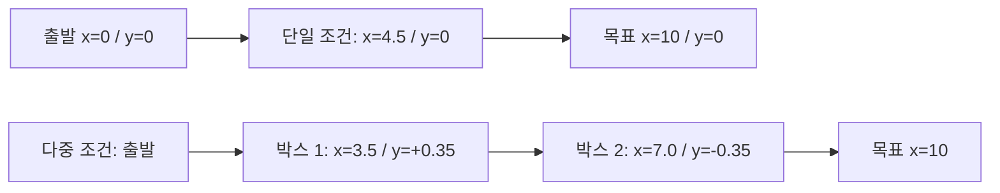

# 추가 실험 세팅과 3일 현장 계획

상태: **미실행 제안**. 범위·용어는 [계획 개요](README.md)를 따른다. 원고와 로봇 코드를 이 계획 작성 과정에서 변경하지 않았다.

## 1. 실험 목록과 준비 완료 조건

| ID | 우선순위 / 리뷰 | 목적 | 취득 규모 |
| --- | --- | --- | --- |
| E1 | 필수 / U1~U3 | 환경·형상·개수 변화에 따른 현재 시스템의 폐루프 성능 | 2환경 × 3조건 × 10회 = 60회 |
| E2 | 권장, U4 근거 미복구 시 필요 | 독립 거리 정답이 있는 baseline 비교 입력 | 2환경 × 3거리 × 3독립 배치 = 18클립 |
| E3 | 조건부 / U2 | 실패 재현 후 특정 수정의 효과 검증 | 사전에 별도 결정. E1에 자동 포함하지 않음 |
| E4 | 후순위 / Access 신규 요구 | 물리 LiDAR·장착 변화·보행자·저사양 보드 | 이번 3일 기본안에 포함하지 않음 |

본 평가를 시작하기 전 다음을 확인한다. 미충족 상태에서 반복 횟수만 늘리지 않는다.

- **G1 장비:** 현장 운영자가 모터·정지 수단·카메라·배터리·충전·보관 용량을 점검. 이번 SSH 조회로 주행 정상 작동이 검증된 것은 아니다.
- **G2 입력/기하:** 실제 실행 모델 클래스와 마스크 처리 확인. `person/floor` 2클래스인데 현재 소스에는 클래스 필터 없이 마스크 합집합을 하는 경로가 있다. 바닥만 쓰는지 원본 프레임으로 검증하고 문제 발견 시 수정·재검증 시간을 따로 배정. 카메라 위치·장착 높이/틸트와 `base_link/lidar_link` 외인자 확인.
- **G3 실행 설정:** YAML 파일뿐 아니라 설치/launch 경로와 런타임 파라미터를 확인·저장. 현재 소스의 `inflation=0.75`, `BaseObstacle=5.0`, `sim_time=2.5`, 최고 선속도 `0.30 m/s`는 출발점이며 검증된 최적값이 아니다. 원고 제안값을 무조건 덮어쓰지 않음.
- **G4 관측:** pilot bag을 직접 열어 영상·scan·odom·cmd·경로·시각 정렬 확인. action 종료 상태와 관찰 기록도 보존. 주행에 SLAM 등이 실제 사용되는지 노드·TF 연결을 확인해 기록.
- **G5 설계 고정:** 장소·배치·반복·순서·종료 규칙·설정 버전 확정. 예비 주행과 본 평가 구분. 형상 확인이나 튜닝에 사용한 시도는 본 평가에서 제외하되 기록은 보존.

## 2. 장소와 장비 준비

| 항목 | 환경 A | 환경 B |
| --- | --- | --- |
| 장소 | 기존 기준 홀 또는 동급의 열린 실내 | A와 다른 실제 장소 |
| 조건 | 상대적으로 균일한 조명 | 바닥 반사/창문 조명 변화가 있는 구간 |
| 공간 | 10 m 주행 구간과 출발·종료 여유, 우회 폭 | 같은 목표 길이와 우회 여유 확보 |
| 기록 | 장소 식별자, 폭, 바닥, 광원, 시각, 사진 | 동일 항목과 역광 방향·반사 위치 |

폭 4~6 m 정도의 열린 공간을 후보로 삼되, 실제 통과 가능 폭과 각 조건의 공간은 pilot으로 확인한다. 기존 근거리 사각지대·측면 관측 제약 때문에 1.6~1.8 m 좁은 복도를 필수 성공 코스로 지정하지 않는다. 좁은 공간은 기존 영상의 운용 한계 사례 또는 별도 명시된 평가로 다룬다.

준비물: OMO-R1·충전 장비, 규격 박스 2개, 고정 가능한 의자/카트 1개, 줄자/레이저 거리계, 제거 가능한 바닥 표식, 외부 촬영 장치, 기록지와 백업 저장소. 조도계를 확보하면 lux를 기록하고, 없으면 조명 유형·시간·카메라 노출 설정을 기록한다. 사진 밝기를 lux로 대체하지 않는다. 최소 운영 1명과 관찰·기록 1명을 배치한다.

## 3. E1: 좌표와 장애물 배치

출발 시 `base_link` 지면 투영 위치를 원점, 전방을 +x, 좌측을 +y로 둔다. 로봇 기준점의 실제 위치를 먼저 확인하고 바닥에 원점·전방 축·10 m 목표를 표시한다. 센서 기준점까지의 거리와 이 좌표를 혼동하지 않는다.

| 조건 | 장애물 | 배치 제안 (m) | 의도 |
| --- | --- | --- | --- |
| S1 | 박스 1개 | `(4.5, 0)` | 기존 단일 박스 기준 조건 |
| S2 | 의자 또는 카트 1개 | `(4.5, 0)` | 다른 형상. 두 환경에서 같은 물체를 사용 |
| S3 | 박스 2개 | `(3.5, +0.35)`, `(7.0, -0.35)` | 연속 회피와 다중 장애물 |

물체 중심 좌표를 계획표에 기록하고 바닥 경계/전면 위치와 크기도 측정한다. 과거 박스 규격 `0.40 × 0.40 × 0.50 m`는 실제 물체를 재측정한 후 사용한다. S2는 실물 선정 전이므로 계획표의 `other_static`을 실제 물체 ID로 확정한다. S3의 공간과 연속 회피 가능성은 pilot 후 확정한다.

다이어그램은 배치 개념도이며 측정 도면이나 실제 회피 궤적이 아니다. S2는 형상, S3는 개수·배치가 함께 바뀌므로 이 설계만으로 모든 요소의 독립적인 인과 효과를 추정하지 않는다.

계획표는 조건별 10회, 환경당 30회다. S1/S2/S3를 각각 1회씩 포함하는 10개 블록으로 구성하고 블록 내 순서는 고정 seed `20261113`으로 섞었다. 현장 제약으로 순서를 바꾸면 실제 순서·시간·사유를 기록한다. 기대 성능이나 관측 결과에 따라 유리한 조건만 재시도하지 않는다.

## 4. 결과 판정과 매 회차 절차

**제안 판정:** Nav2가 성공을 반환하고 표시한 목표 위치의 허용 오차 0.25 m 이내에 도달하며, 접촉·수동 개입이 없으면 성공이다. 외부 관찰과 Nav2 판정이 다르면 둘 다 기록하고 사전 판정 규칙으로 처리한다. yaw 정확도는 이번 주요 지표로 두지 않는다.

- 제한 시간은 목표 수락 시점부터 120초를 시작안으로 잡고 pilot 후 본 평가 전에 고정한다. 기존 기본 60초 및 과거 기록과 다르면 직접 동등 비교라고 쓰지 않는다.
- 최종 outcome: `success`, `collision`, `timeout`, `nav_abort`, `manual_intervention`, `invalid` 중 하나. 즉시 정지·회수한 경우 실제 원인과 개입도 별도 기록한다.
- 충돌·시간초과·주행 실패는 실패 분모에 포함한다. `invalid`는 주행 전 로그 누락 등 사전에 정한 절차적 무효만 적용하고 이유·원본을 남긴다. 실패를 무효로 바꾸지 않는다.
- 설정 변경 시 새 프로토콜/실험군으로 분리. E3 전후 검증은 같은 조건·같은 종료 기준으로 사전 지정한 전체 반복을 수행하며 성공 횟수를 미리 약속하지 않는다.

회차 절차: 배치/장애물 ID 확인 → 초기 위치·헤딩 및 costmap/노드 초기 상태 확인 → 녹화·외부 촬영 시작 → 목표 전송 → 관찰·종료 → 판정/설정/파일 ID 기록 → bag 완결성 확인 → 출발점 복귀. 캐시·이전 장애물 흔적을 포함한 초기 상태를 회차 간 일관되게 유지한다.

시간은 **목표 수락부터 결과/취소까지의 경과 시간**을 기본으로 한다. 첫 이동부터 종료까지의 시간, 속도 임계값을 넘은 누적 이동 시간은 정의가 다른 보조 지표로 분리한다. 실패한 주행 시간도 남기고 성공 주행 평균에는 표본 수를 명시한다.

## 5. 녹화와 현장 피규어 촬영

`scripts/record_rosbag.sh`의 `nav` 모드를 출발점으로 검토한다. 예전 `minimal`은 영상이 없고, `vlidar`는 cmd/계획 정보가 빠질 수 있어 이번 목적의 기본값으로 삼지 않는다. 아래는 **취득 요구사항**이며 이 문서 작성 중 실행하지 않았다.

| 종류 | 확보 내용 |
| --- | --- |
| 필수 센서/주행 | `/camera/image_raw`, `/scan`, `/lidar_channel_distances`, `/floor_detector`, `/odom`, `/cmd_vel`, `/tf`, `/tf_static` |
| 계획/진단 | `/plan`, `/local_plan`, 실제 발행 중인 costmap 및 가능한 planner/controller 진단. 실제 토픽·타입·QoS를 먼저 확인 |
| 목표/판정 | Nav2 action goal/result 및 시간. `/goal_pose`만 녹화하면 action client가 보낸 목표를 포착하지 못할 수 있음. CLI 출력/구조화 로그도 별도 보관 |
| 설정 | 소스 commit, 실제 실행 YAML/런타임 파라미터, 모델·LUT 해시, 카메라 기하·노출, 실행 노드 목록 |
| 외부 기록 | 주행 전 공간 사진, 물체 크기·바닥 좌표 사진, 접근/회피/복귀가 보이는 고정 시점 영상, 충돌·개입 관찰 |

카메라·주행 bag·외부 영상은 공통 시작 표식/타임스탬프로 대응시킨다. 전체 메시지 수만 보지 말고 영상이 실제 디코딩되는지, 시간 간격·드롭·누락이 있는지 확인한다. 스캔/궤적은 각 회차 원점과 초기 yaw로 정규화하되 절대 GT라고 부르지 않는다.

현장에서 반드시 촬영할 F03용 환경 A/B 전경과 치수, S1~S3 배치, 로봇 장착 측면, F04용 외부 주행 영상은 [피규어 계획](02_Figure_and_Table_Plan.md)과 연결한다. 결과를 보기 전에 대표 주행 선정 규칙을 정한다.

## 6. E2: baseline 비교용 정적 입력

기존 baseline 원자료가 적절한 GT·보정/평가 분리·백엔드 기록까지 재현되면 추가 취득 필요성을 재판단한다. 그렇지 않으면 아래 자료를 1일차에 확보한다.

- 같은 박스를 센서 기준 독립 거리 `2.5 / 3.5 / 4.5 m`에 두고, 환경 A/B에서 거리별 3회 **물체를 다시 배치·측정**한다. 18개 클립, 각 약 10초. 계획표는 `static_reference_plan.csv`.
- 거리는 카메라/scan 기준점에서 보이는 바닥 접촉 전면까지의 수평 거리로 정의하고, 줄자/거리계와 센서 외인자·표적 방위각으로 확인한다. 기기 정확도·측정 방법 기록. 카메라 높이의 경사거리를 그대로 GT로 쓰지 않는다.
- 각 환경·거리의 placement 1은 calibration, 2/3은 held-out evaluation으로 사전 분리한다. 즉 6개 보정 클립과 12개 평가 클립이다. MDE의 scale/shift는 보정 자료로만 정하고 이후 고정한다. 이는 측정 기반 metric calibration을 사용하는 비교임을 명시한다.
- 같은 클립의 연속 프레임은 독립 표본이 아니다. 클립/재배치 단위를 표시하고 MAE·bias·분산·무검출률과 샘플 수를 함께 보고한다. 범위 밖 출력·무검출을 임의 거리로 채우지 않는다.
- 조명 민감도만 분리하려면 같은 장소·물체·거리에서 조명만 바꾸는 별도 쌍을 추가한다. 현재 두 장소 설계만으로 조명의 독립 효과를 주장하지 않는다.

MDE 재추론과 지연 측정은 별도 오프라인 실험이다. 하드웨어·스레드·백엔드·정밀도·입력 크기·warmup·측정 구간을 고정하고, 같은 백엔드 비교와 실제 배포 조합 비교를 구분한다. 센서 비교를 폐루프 회피 성공률 비교로 확대 해석하지 않는다.

## 7. 일정, 담당 역할, 완료 조건

| 단계 | 작업 / 담당 역할 제안 | 종료 조건 |
| --- | --- | --- |
| 학회지 작업 중 사전 준비 | 분석 담당: 기존 수치 출처·자산 목록. 현장 담당: 장소·물체·충전·저장 확인 | 장소·필수 데이터·준비물 확정 |
| 1일차 | 운영+기록 2명: G1~G5, 양 환경 pilot, E2 18클립, 환경/장착 사진 | 설정·판정 고정, 실제 녹화 확인. 미완료면 일정 재산정 |
| 2일차 | 환경 A 30회, 중간 무결성·용량 확인 | A의 전체 시도와 원자료 연결표 |
| 3일차 | 환경 B 30회, 누락 확인·추가 기록·백업 | B의 전체 시도, 누락 목록, 백업 검증 |
| 별도 | 분석 담당: baseline/그림/통계/원고 대응 | 그림·표의 수치와 출처 재현 가능 |

회당 주행·복귀·기록을 5~10분으로 **가정**하면 60회는 5~10시간이다. 여기에 장소 이동·pilot·설정·충전·정적 측정·데이터 확인이 추가된다. 3일은 두 명이 현장 시간을 확보하고 큰 구현 수정이 없을 때의 목표이며 여유가 크지 않다. 첫날 pilot에서 실제 회차 시간을 측정해 다시 계산한다.

장소 미확보, 실제 실행 버전 불명, 녹화 손실, 중요한 인식/제어 결함, pilot 후 설정 미고정이면 본 평가를 미루고 새 종료일을 공유한다. 시간을 맞추기 위해 30회로 줄일 경우 프로토콜 변경으로 기록하고 조건별 5회라는 한계를 보고한다. 기본 계획표 60회를 완료한 것처럼 보고하지 않는다.

최종 완료는 “원하는 성공률 달성”이 아니라 **사전에 정한 전체 시도의 결과와 원자료가 분석 가능하게 확보됨**이다. 78%(39/50)와 90%(18/20)는 조건이 다른 과거 실험일 수 있으므로 그대로 개선율의 인과 근거로 쓰지 않는다.
