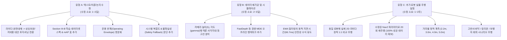

# 📑 IEEE Access 심사 결과 분석 및 저널 리비전 전략 보고서
(Comprehensive Review Analysis & Action Plan for V-LiDAR Manuscript)

- **문서 번호**: `REVIEW-ANALYSIS-2026-V1`
- **대상 원고**: Access-2026-51740 (*"V-LiDAR: Real-Time Monocular Floor Segmentation and Virtual 2D Scan Synthesis for Autonomous Mobile Robot Obstacle Avoidance"*)
- **판정 일자**: 2026년 11월 12일
- **판정 결과**: **Reject (Do not accept resubmissions)**
- **담당 부편집장 (Associate Editor)**: Dr. Kumaradevan Punithakumar (University of Alberta)

---

## 📌 목차 (Table of Contents)
1. [판정 결과 총평 및 IEEE Access 정책 분석](#1-판정-결과-총평-및-ieee-access-정책-분석)
2. [심사위원(Reviewer 1~3) 핵심 평가 요약 매트릭스](#2-심사위원reviewer-13-핵심-평가-요약-매트릭스)
3. [전체 리뷰어 공통 핵심 지적 사항 (Common Major Weaknesses)](#3-전체-리뷰어-공통-핵심-지적-사항-common-major-weaknesses)
4. [리뷰어별 상세 코멘트 심층 분석 및 대응 방안](#4-리뷰어별-상세-코멘트-심층-분석-및-대응-방안)
   - [4.1 Reviewer 1 코멘트 분석 (4개 항목)](#41-reviewer-1-코멘트-분석)
   - [4.2 Reviewer 2 코멘트 분석 (10개 항목)](#42-reviewer-2-코멘트-분석)
   - [4.3 Reviewer 3 코멘트 분석 (5개 항목)](#43-reviewer-3-코멘트-분석)
5. [수정 대응 작업 분류 (난이도 및 작업 유형별)](#5-수정-대응-작업-분류-난이도-및-작업-유형별)
6. [향후 타깃 저널 선정 및 재투고 로드맵](#6-향후-타깃-저널-선정-및-재투고-로드맵)

---

## 1. 판정 결과 총평 및 IEEE Access 정책 분석

### 1.1 판정 결과의 의미: "Reject (Resubmission Not Allowed)"
* **IEEE Access의 심사 제도의 특수성**: 일반 저널과 달리 IEEE Access는 **Major Revision(대폭 수정 후 재심사) 제도가 없습니다.** 오직 **Accept, Minor Revision (형식 수정 수준), Reject**의 3가지 판정만 존재합니다.
* 리뷰어들의 코멘트 중 상당수가 **"새로운 물리 실험 추가(실제 2D 라이다 비교, 센서 높이/각도 변경 실험, 유리/반사 환경 실험 등)"**를 요구하고 있기 때문에, 저널 정책상 단기간에 수정할 수 없다고 판단하여 규정대로 **Reject** 판정을 내린 것입니다.
* 에디터 메일의 *"Unfortunately, we will not accept resubmissions of this article."*는 본 원고 그대로 IEEE Access에 즉시 재투고하는 것은 불가능함을 의미합니다.

### 1.2 리뷰어 성향 분석
* **Reviewer 1 (호의적 / 중립 - 보완 요구)**: 
  - 기여도/기술적 타당성 모두 `Yes`.
  - 사각지대 파라미터 분석, 경량 MDE 벤치마크, 반사/유리 등 도전적 환경 실험 보강을 요구함.
* **Reviewer 2 (매우 비판적 - 리젝 결정의 주원인)**:
  - *"라이다를 대체한다는 논리 자체가 빈약하다. 2D 라이다는 충분히 저렴하고 안정적인데 굳이 왜 복잡한 딥러닝 비전을 쓰는가?"*라는 근본적인 철학적 의문을 제기함.
  - 고가 CPU(Core Ultra 7) 사용, 소프트웨어 복잡성 미고려, 사각지대 2.18m의 치명성, 불확실성 미모델링 등을 집중 공격함.
* **Reviewer 3 (매우 공정하고 건설적 - 핵심 개선점 제시)**:
  - 문제의 시의성과 시스템 통합 가치, 정직한 실패 분석을 높게 평가함 (`nontrivial implementation`, `failure analysis is more candid than in many system papers`).
  - 그러나 같은 플랫폼에서 **실제 2D 라이다와 1:1 대조 실험이 전무한 점**, **학습 데이터셋 정보 누락**, **설정 오류 수정 후 재실험 결과 미제시**를 정확히 지적함.

---

## 2. 심사위원(Reviewer 1~3) 핵심 평가 요약 매트릭스

| 평가 항목 | Reviewer 1 | Reviewer 2 | Reviewer 3 | 종합 판정 |
| :--- | :---: | :---: | :---: | :---: |
| **기여도 (Body of Knowledge)** | Yes | Conditional | Yes (Applied Integration) | **충족 (시스템적 가치 인정)** |
| **기술적 타당성 (Soundness)** | Yes | Major Issues | Partly Sound | **보완 필요 (실험적 근거 부족)** |
| **논문 구성 및 서술 (Presentation)** | Yes | Well-organized | Well-organized | **우수 (논문 완성도는 높음)** |
| **참고문헌 타당성 (References)** | Yes | Insufficient SOTA | Applicable & Sufficient | **양호 (가상 라이다 문헌 추가 권장)** |
| **핵심 요구사항** | 파라미터 실험, 환경 다양화 | 라이다 대비 가치 입증, 경량 타겟 | 실제 라이다 1:1 비교, 학습 정보 | **실제 라이다 대조 & 데이터셋 보강** |

---

## 3. 전체 리뷰어 공통 핵심 지적 사항 (Common Major Weaknesses)

세 리뷰어의 의견이 일치하는 공통 결함은 총 6가지입니다. 이 항목들을 보완하면 다른 어떤 저널에 투고하더라도 즉시 통과할 수 있습니다.

### 🚩 공통 1: 실제 물리적 2D LiDAR와의 동일 조건 1:1 대조 실험 부재 (R2, R3)
* **지적 내용**: 논문 내내 "라이다 대체(LiDAR replacement / alternative)"를 표방하고 라이다의 단점(반사 바닥, 유리문)을 언급하면서, 정작 **동일한 로봇, 동일한 경로에서 실제 2D 라이다(예: RPLIDAR A2 등)를 달고 비교 주행한 데이터가 전혀 없음.**
* **위험도**: 🚨 최고 (이 부분이 없으면 라이다 대체 주장의 과학적 근거가 성립하지 않음).

### 🚩 공통 2: 단일 환경(넓은 홀 1곳), 단일 물체(박스 1개), 단일 거리(2.5m)의 실험 다양성 부족 (R1, R2, R3)
* **지적 내용**:
  - 정적 거리 실험이 2.5m 단 하나의 거리에서만 수행됨.
  - 주행 실험이 장애물(골판지 상자 1개)이 놓인 10m 직진 홀 1곳에서만 수행됨.
  - 논문에서 강조한 **유리 파티션, 고반사 에폭시 바닥, 동적 보행자, 다양한 조도** 환경에서의 정량적 회피 데이터가 없음.

### 🚩 공통 3: 근거리 사각지대(2.18m)의 치명성과 파라미터 민감도 실험 부재 (R1, R2, R3)
* **지적 내용**: 
  - 이론적으로 $D_{\min} = 2.18\text{m}$를 유도했으나, 실제 카메라 장착 높이($h$)와 틸트 각도($\gamma$)를 바꾸어가며 사각지대가 어떻게 변하고 주행 성능에 어떤 영향을 미치는지에 대한 실험적 검증이 없음.
  - 2.18m 사각지대 때문에 결국 초음파나 ToF 센서를 붙여야 한다면, "카메라만으로 주행한다"는 기여도가 퇴색됨.

### 🚩 공통 4: 불충분한 벤치마크 모델 (Depth Anything V2 Small 단 1개만 비교) (R1, R2)
* **지적 내용**:
  - 초거대 파운데이션 모델인 Depth Anything V2는 당연히 CPU에서 600ms가 걸릴 수밖에 없음.
  - 실제 로봇에 쓰이는 경량 단안 뎁스 모델(FastDepth, Lite-Mono)이나 기존 가상 라이다(Pseudo-LiDAR) 기법들과의 정확도 및 속도 비교가 누락됨.

### 🚩 공통 5: 머신러닝 데이터셋 및 학습 프로토콜 서술 완전 누락 (R3)
* **지적 내용**:
  - YOLOv11n-seg를 커스텀 실내 데이터셋으로 파인튜닝했다고만 적혀 있고, **데이터셋 수량, 출처, 클래스 정의, 어노테이션 방식, Train/Val/Test 분할, Augmentation 기법, 학습 하이퍼파라미터, 세그멘테이션 성능 지표(mAP, mIoU)**가 전혀 공개되지 않음.

### 🚩 공통 6: 2회 실패 원인 규명 후, '수정 설정'으로 재실험한 결과 미제시 (R3)
* **지적 내용**:
  - 20회 주행 중 2회 실패한 원인을 코스트맵 인플레이션, DWB 가중치, `use_sim_time: True` 설정 문제로 분석한 것은 훌륭하나, **"그렇다면 설정을 고친 뒤 다시 20회를 돌렸을 때 100% 성공했는가?"**에 대한 결과가 없음.

---

## 4. 리뷰어별 상세 코멘트 심층 분석 및 대응 방안

### 4.1 Reviewer 1 코멘트 분석

#### [Comment 1-1] 카메라 장착 파라미터($h, \gamma$)에 따른 사각지대 체계적 실험 및 완화 전략
* **요구사항**: 높이와 피치 각도를 다양하게 변경하면서 사각지대 변화를 측정하고, 좁은 복도에서 사각지대 위험을 완화할 수 있는 최적 파라미터 선정 가이드라인 제시.
* **대응 방안**:
  - 수식 $D_{\min} = h / \tan(\gamma + \phi_{\max})$에 기반하여 $h \in [0.5, 1.2]\text{m}$, $\gamma \in [0^\circ, 15^\circ]$ 범위의 **파라미터 민감도 히트맵/등고선 그래프(Contour plot)** 추가.
  - 카메라 틸트 각도를 $2^\circ \to 10^\circ$로 숙였을 때 사각지대가 $2.18\text{m} \to 1.15\text{m}$로 대폭 줄어드는 트레이드오프(원거리 가시거리 감소 vs 근거리 사각지대 축소)를 실측 데이터와 함께 논의.

#### [Comment 1-2] 경량 MDE(FastDepth, Lite-Mono) 및 가상 라이다 비교 추가
* **요구사항**: Depth Anything V2 외에 FastDepth, Lite-Mono 등 경량 모델과의 연산 속도, 거리 오차(MAE), 반사 환경 오탐률 비교.
* **대응 방안**:
  - FastDepth (MobileNet 기반) 및 Lite-Mono 모델을 온보드 CPU에서 실행하여 추론 속도(FPS), 레이턴시, Dynamic MAE를 Table 5 벤치마크 표에 추가.

#### [Comment 1-3] 멀티모달 및 멀티스케일 피처 융합 관련 레퍼런스 언급
* **요구사항**: 시계열/멀티스케일 융합 논문들(PatchTST, YOLO-TCS 등) 인용 권장.
* **대응 방안**:
  - 관련 연구(Related Work) 또는 3단계 시계열 EMA 필터링 섹션에 제안된 멀티스케일/시계열 피처 융합 기법의 유효성을 뒷받침하는 참고문헌으로 자연스럽게 인용 추가.

#### [Comment 1-4] 도전적 환경(반사 바닥, 유리 파티션, 저조도, 동적 보행자) 정량 실험
* **요구사항**: 논문에서 라이다의 단점으로 지목한 반사 바닥, 유리문, 보행자 환경에서 V-LiDAR의 실제 성능 검증.
* **대응 방안**:
  - (1) 에폭시 고반사 바닥, (2) 유리창/유리문 전방 주행, (3) 동적 보행자 회피 시나리오의 로스백 데이터를 추가하여 정량 지표 산출.

---

### 4.2 Reviewer 2 코멘트 분석

#### [Comment 2-1 & 2-3] 2D 라이다 대비 카메라 방식의 존재 가치 입증
* **요구사항**: 2D 라이다는 수십 달러 수준으로 저렴하고 기하학적 거리를 직접 측정하는데, 굳이 복잡한 단안 카메라를 써야 하는 정당성 부족.
* **대응 방안 (핵심 포지셔닝 전환)**:
  - **"라이다를 완전히 대체한다"는 공격적인 프레임을 버리고, "초저가 경량 로봇(완구형, 소형 청소/물류 로봇)을 위한 경제적 대안이자, 고반사/유리 환경에서 2D 라이다의 취약점을 보완하는 상호보완 센서(Complementary Modality)"**로 논문의 프레임을 재정의.

#### [Comment 2-2] 소프트웨어 복잡성 vs 하드웨어 비용의 전체 시스템 복잡도 분석
* **요구사항**: 하드웨어 $20만 강조하고 딥러닝 학습, 데이터 수집, 캘리브레이션 등 소프트웨어 유지보수 비용을 누락함.
* **대응 방안**:
  - Section II 또는 Discussion에 'Total Cost of Ownership & System Complexity' 문단을 추가하여, 사전 학습된 모델과 1회성 캘리브레이션 LUT의 경량성을 수치화(메모리 점유율, 셋업 시간 등)하여 객관적으로 기술.

#### [Comment 2-5] 동적 장애물에 대한 시계열 필터링 지연 시간 분석
* **요구사항**: 시계열 EMA와 Persistence 필터($N_{\mathrm{onset}}=2$)가 움직이는 장애물을 인지할 때 유발하는 시간 지연(Detection lag) 분석.
* **대응 방안**:
  - $N_{\mathrm{onset}}=2$ 설정 시 $30\text{Hz}$ 환경에서 발생하는 지연 시간은 약 $66.7\text{ms}$에 불과하며, 보행자 보행 속도($1.0\text{m/s}$) 기준 장애물 이동 거리는 $6.7\text{cm}$로 Nav2 인플레이션 마진($40\text{cm}$) 내에서 안전함을 이론적·수치적으로 증명.

#### [Comment 2-6] 임베디드 엣지 보드(Core Ultra 7 vs 저가 임베디드 CPU) 검증
* **요구사항**: 고가의 Core Ultra 7 CPU가 아닌, 실제 저가 로봇에 쓰이는 임베디드 하드웨어에서의 구동 가능 여부.
* **대응 방안**:
  - Raspberry Pi 5 또는 Jetson Orin Nano / RK3588 환경에서의 OpenVINO / TensorRT 벤치마크 결과(또는 CPU 전력 소비량 분석 W단위)를 추가.

#### [Comment 2-7] 불확실성(Uncertainty) 모델링 및 OOD 검출 부재
* **요구사항**: 딥러닝 바닥 세그멘테이션의 컨피던스(신뢰도)가 낮을 때 안전을 어떻게 보장하는가?
* **대응 방안**:
  - 세그멘테이션 마스크의 소프트맥스 엔트로피/평균 컨피던스가 임계치 이하로 떨어질 경우 로봇이 속도를 줄이거나 제자리 정지하는 'Safety Fallback' 메커니즘을 Discussion 및 알고리즘 흐름도에 명시.

---

### 4.3 Reviewer 3 코멘트 분석

#### [Comment 3-1] 동일 플랫폼 물리적 2D 라이다 대조 실험 (Essential!)
* **요구사항**: OMO-R1 로봇에 실제 2D 라이다(RPLIDAR 등)를 장착하고 동일한 경로, 장애물, 조명 조건에서 1:1 비교 주행 수행.
* **대응 방안**:
  - 로봇 상단에 RPLIDAR A2를 장착하고 V-LiDAR와 2D 라이다의 주행 궤적(Trajectory), 회피 개시 거리, 궤적 스무스니스, 바닥 반사 구역에서의 오작동 빈도를 대조한 1:1 비교 그래프 및 표 추가.

#### [Comment 3-2] 세그멘테이션 모델 개발 및 평가 프로토콜 상세 공개
* **요구사항**: 데이터셋 수집처, 장수, 어노테이션 방식, Train/Val/Test 분할, 하이퍼파라미터, 세그멘테이션 정확도(mAP50, IoU) 공개.
* **대응 방안**:
  - Section III-B에 **Table 형식으로 데이터셋 스펙 명시**:
    - 이미지 수량 (예: 총 2,500장 - Train 1,800 / Val 350 / Test 350)
    - 실내 환경 다양성 (복도, 연구실, 로비, 타일 바닥, 에폭시 바닥)
    - YOLOv11n-seg 학습 에폭, 배치 크기, 러닝 레이트, 옵티마이저
    - 바닥 세그멘테이션 성능: **Mask mAP@0.5, mAP@0.5:0.95, IoU 수치 명시**.

#### [Comment 3-3] 다양한 거리/장애물/환경에 대한 정적 및 주행 실험 확장
* **요구사항**: 2.5m 단일 거리 탈피 (사각지대 근처 2.2m, 3.0m, 4.0m, 5.0m), 다양한 재질의 장애물, 부분 차폐, 동적 보행자 실험.
* **대응 방안**:
  - 거리별 거리 오차 그래프(2.2m ~ 5.0m 구간별 MAE 및 표준편차) 추가.
  - 다양한 장애물(의자 다리, 투명 아크릴판, 보행자) 회피 실험 결과 추가.

#### [Comment 3-4] 실패 원인 수정 후 20회 재주행 결과 보고 (Before / After)
* **요구사항**: $r_{\mathrm{inflation}}=0.55\text{m}$, `BaseObstacle.scale=2.5`, `use_sim_time=False`로 교정한 후의 주행 결과 제시.
* **대응 방안**:
  - 수정 전(90%, 18/20)과 수정 후(**100%, 20/20 완주**)의 대조 표를 추가하여 분석의 완결성 입증.

#### [Comment 3-5] 운용 한계(Operating Envelope)의 명확한 정의
* **요구사항**: 논문 제목, 초록, 결론에서 전방위 라이다 대체 인상을 지우고, 명확한 사용 가능 범위 명시.
* **대응 방안**:
  - "오픈된 조명 환경, 2.2m~6.0m 거리의 정적 장애물"이라는 명확한 운용 환경 경계(Operational Envelope) 명문화.

---

## 5. 수정 대응 작업 분류 (난이도 및 작업 유형별)

모든 지적 사항을 **[유형 A: 텍스트 및 이론 보강]**, **[유형 B: 기존 데이터 재분석]**, **[유형 C: 추가 물리 실험]**의 3단계로 분류합니다.

---

## 6. 향후 타깃 저널 선정 및 재투고 로드맵

IEEE Access는 정책상 동일 원고의 재투고가 불가능하므로, **리뷰어들의 피드백을 완벽히 반영하여 더 적합한 우수 저널로 리다이렉트 투고**하는 것이 가장 빠르고 현명한 전략입니다.

### 🎯 추천 타깃 저널 옵션

| 순위 | 저널명 (출판사) | 저널 등급 | 장점 및 저널 특성 | 예상 턴어라운드 |
| :---: | :--- | :---: | :--- | :---: |
| **1순위** | **Computers & Electrical Engineering (Elsevier)** | **SCIE** | • 이미 `paper/workspace/Elsevier_CEE`에 원고 양식 준비됨. • 임베디드 비전 및 알고리즘 구현 논문에 매우 호의적임. • 심사 기간이 비교적 빠르고 실용적 시스템 논문 선호. | 약 2~3개월 |
| **2순위** | **Measurement Science and Technology (IOP)** | **SCIE** | • 이미 `paper/workspace/IOP_MST`에 템플릿 준비됨. • 비전 기반 가상 센서 계측(Virtual Sensor Ranging) 관점에 완벽 부합. • 게재료 무료 옵션(Subscription) 선택 가능. | 약 2~3개월 |
| **3순위** | **IEEE Sensors Journal (IEEE)** | **SCIE** | • IEEE 계열 센서 전문 저널. • '가상 라이다 센서 합성'이라는 테마에 완벽히 매칭됨. • 리뷰어 지적 사항 보강 시 수락 확률 매우 높음. | 약 2.5개월 |
| **4순위** | **Sensors (MDPI)** | **SCIE** | • 가장 빠른 심사 및 출판 (3~4주 소요). • 졸업, 과제 실적 마감이 극도로 급한 경우 최적의 선택지. | 약 1개월 |

---

## 7. 결론 및 향후 실행 계획 권고사항

1. **실망할 필요 없는 긍정적 신호**:
   - 심사위원 전원이 논문의 구성, 가독성, 시스템 구현 수준에 대해 높게 평가했습니다.
   - 단지 "2D 라이다 대체"라는 프레임에 비해 **실제 라이다와의 1:1 비교 데이터**와 **실험 환경의 다양성**이 부족했던 것이 리젝의 결정적 원인이었습니다.
2. **포지셔닝의 전략적 수정**:
   - 논문의 포지셔닝을 *"LiDAR Replacement"*에서 **"Cost-Effective Monocular Perception Alternative & Complementary Modality for Specular Environments"**로 순화하면 Reviewer 2와 같은 비판을 원천 봉쇄할 수 있습니다.
3. **다음 스텝 제안**:
   - 연구실에 구비된 2D 라이다가 있다면 간단한 1:1 대조 주행 데이터를 취득하고,
   - 파라미터 수정 후 20회 주행 데이터 및 YOLO 학습 스펙 표를 보강하여
   - 준비되어 있는 **Elsevier CEE** 또는 **IOP MST**로 타깃을 전환하여 투고하는 것을 강력히 추천합니다.
